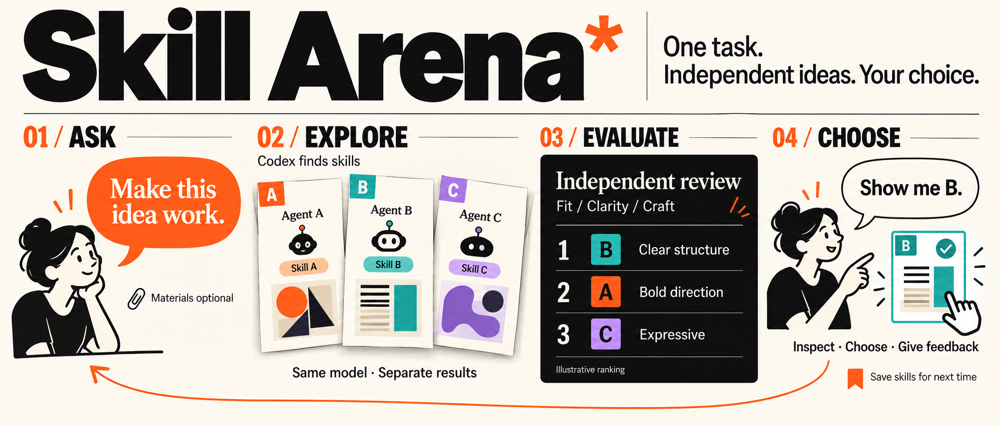

  

<h1 align="center">Skill Arena</h1>

<strong>同一个任务，多种 skill 分别尝试，帮你选出更合适的结果。</strong>

---

## 它能帮你做什么？

面对几款看起来都不错的 skill，你可能不知道哪一款更适合自己的任务。Skill Arena 会帮你寻找合适的 skill，让它们各自完成一次任务，再比较实际结果，而不是只看介绍或热度。

你只需要说清楚想做什么。**有材料就附上，没有也可以直接开始。**

例如，你想规划一篇英文期刊论文：Skill Arena 会挑选 3–5 款适合的学术 skill，分别生成完整方案，再由一个未参与生成的 Codex 评估这些方案，解释各自的优点、缺点和适用场景。

## 怎么使用？

将本项目作为 skill 添加到 Codex 后，直接说：

> 使用 $skill-arena，帮我规划一篇关于强化学习辅助建筑结构设计的英文期刊论文。

也可以用于其他任务：

> 使用 $skill-arena，帮我制作一份介绍研究成果的演示文稿。

还没有添加 skill？把项目下载到本地，让 Codex **“读取这个项目的 SKILL.md，并用它完成我的任务：……”** 即可。

## 它会怎样完成任务？

| 步骤 | 你会得到什么 |
| --- | --- |
| **寻找候选** | 自动调查并选择 3–5 款适合任务的 skill |
| **分别完成** | 每款 skill 单独完成一份结果，互不混用 |
| **比较评价** | 用同一套任务要求检查结果，给出排名和具体依据 |
| **留下记录** | 保存完整结果、对比报告和 skill 来源，方便以后复用 |

所有方案使用**相同的 Codex 模型**。每款 skill 可以按自己的方式完成任务，不要求耗时、token 数或预算相同。默认还会生成一份不使用候选 skill 的结果，帮助你判断这些 skill 是否带来了实际改善。

## 结果怎么看？

- **先看对比报告**：快速了解推荐顺序、主要差异，以及哪份结果更适合你。
- **再看完整方案**：每款 skill 的结果都会单独保留，方便逐份查看。
- **以后继续复用**：遇到相似任务时，优先找回曾经用过的 skill，并结合新任务重新判断。

评分接近时可以并列；证据不足时会说明原因。一次结果更好，不代表这款 skill 在所有任务中都更好。

<strong>想了解具体规则？</strong>

- [完整工作流程](SKILL.md)
- [提示词模板](references/prompts.md)
- [评价方法](references/evaluation.md)
- [文件与记录管理](references/storage.md)
- [研究参考与设计考虑](references/research.md)

